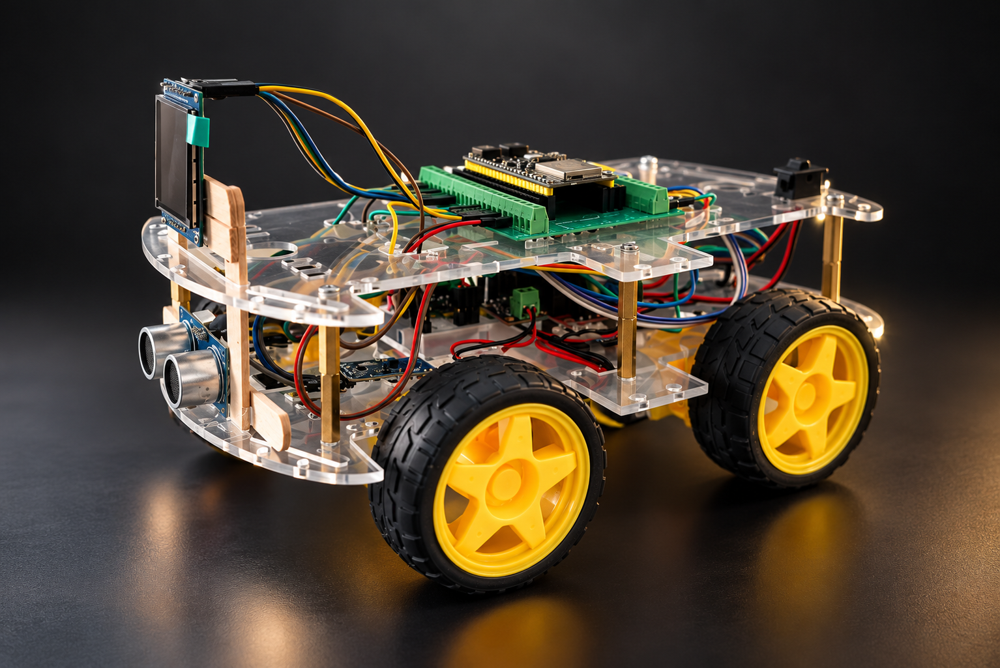

# Ruby RobotCar

**English** | [Tiếng Việt](README.vi.md)

ESP32-S3 robot firmware customized from [XiaoZhi ESP32](https://github.com/78/xiaozhi-esp32).



## Development direction

1. **Stage 1: Differential Drive Robot** — complete the ESP32-S3 low-level controller: speed, heading, distance, odometry and safety.
2. **Stage 2: AI Autonomous Robot** — use a Samsung Z Flip 5 as the main computer for AI, conversation and autonomous behavior, with control over model selection and deployment.

The ESP32 keeps motion control and safety; the phone will send goals and receive telemetry. The planned AI layer may use a model on the phone or a self-managed server; XiaoZhi integration is optional.

## Hardware

1. **ESP32-S3-N16R8** — controller board.
2. **4 DC motors** — drive the four wheels.
3. **2 L298N modules** — motor drivers.
4. **2 FC-03 encoders** — measure front-wheel motion.
5. **MPU6050 IMU** — provides motion and heading data.
6. **HC-SR04** — mounted facing forward to measure distance.
7. **I2S microphone** — captures audio.
8. **MAX98357A** — amplifies audio for the speaker.

No physical display.

## Build and flash

Use ESP-IDF v6.1 when possible (minimum v6.0.1; IDF 5.x unsupported). Initialize the IDF environment and prepare the required [Telegram settings](docs/custom-board.md) first.

```sh
python scripts/build.py
idf.py -p <SERIAL_PORT> flash monitor
```

## Documentation

- [Requirements and progress](docs/robot/ROBOT_4WD_REQUIREMENTS.md)
- [Architecture](docs/ARCHITECTURE.md)
- [Wiring](docs/robot/BOARD_GUIDE.md) · [Board configuration](docs/custom-board.md)
- [Audio](components/audio/README.md) · [WebSocket](docs/xiaozhi/websocket.md) · [MQTT/UDP](docs/xiaozhi/mqtt-udp.md) · [MCP](docs/xiaozhi/mcp-protocol.md)

[MIT License](LICENSE). Preserve the original copyright and license notices.
