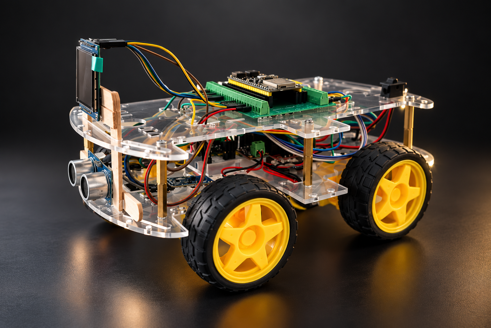

# Ruby RobotCar

[English](README.md) | **Tiếng Việt**

Firmware robot ESP32-S3 tùy biến từ [XiaoZhi ESP32](https://github.com/78/xiaozhi-esp32).



## Định hướng

1. **Giai đoạn 1: Differential Drive Robot** — hoàn thiện low-level controller trên ESP32-S3: tốc độ, hướng, quãng đường, odometry và safety.
2. **Giai đoạn 2: AI Autonomous Robot** — dùng Samsung Z Flip 5 làm bộ não chính cho AI, hội thoại và hành vi tự hành; chủ động lựa chọn model và nơi triển khai.

ESP32 giữ điều khiển chuyển động và safety; điện thoại sẽ gửi mục tiêu và nhận telemetry. Tầng AI dự kiến có thể dùng model trên điện thoại hoặc máy chủ tự quản lý; tích hợp Xiaozhi là tùy chọn.

## Phần cứng

1. **ESP32-S3-N16R8** — board điều khiển.
2. **4 motor DC** — truyền động cho bốn bánh xe.
3. **2 module L298N** — driver điều khiển motor.
4. **2 encoder FC-03** — đo chuyển động hai bánh trước.
5. **IMU MPU6050** — cung cấp dữ liệu chuyển động và hướng.
6. **HC-SR04** — đo khoảng cách phía trước.
7. **Servo** — giữ HC-SR04 hướng giữa.
8. **Microphone I2S** — thu âm.
9. **MAX98357A** — khuếch đại âm thanh cho loa.

Không dùng màn hình vật lý.

## Build và nạp

Ưu tiên ESP-IDF v6.1 (tối thiểu v6.0.1; không hỗ trợ IDF 5.x). Khởi tạo môi trường IDF và chuẩn bị [cấu hình Telegram](docs/custom-board.md) bắt buộc trước.

```sh
python scripts/build.py
idf.py -p <SERIAL_PORT> flash monitor
```

## Tài liệu

- [Yêu cầu và tiến độ](docs/robot/ROBOT_4WD_REQUIREMENTS.md)
- [Kiến trúc](docs/ARCHITECTURE.md)
- [Nối dây](docs/robot/BOARD_GUIDE.vi.md) · [Cấu hình board](docs/custom-board.md)
- [Audio](components/audio/README.md) · [WebSocket](docs/xiaozhi/websocket.md) · [MQTT/UDP](docs/xiaozhi/mqtt-udp.md) · [MCP](docs/xiaozhi/mcp-protocol.md)

[Giấy phép MIT](LICENSE). Giữ thông báo bản quyền và giấy phép gốc.
