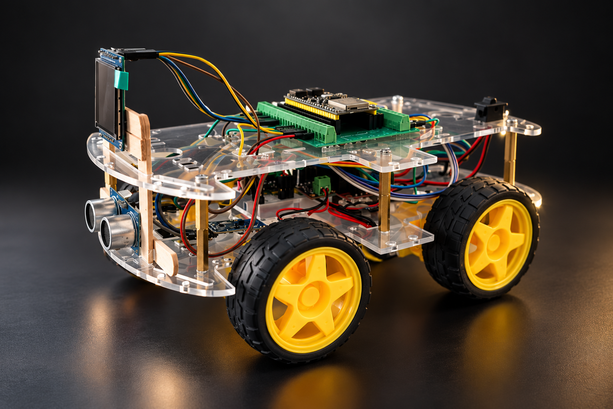

# Ruby RobotCar

[English](README.md) | **Tiếng Việt**

Dự án học tập về robot di động và firmware ESP32. Ruby RobotCar kết hợp firmware trợ lý giọng nói XiaoZhi với khung xe 4 bánh, giúp bạn tìm hiểu cách phần mềm nhúng kết nối phần cứng, đọc cảm biến và nhận lệnh điều khiển.



Source hiện được cấu hình cho một bộ phần cứng cụ thể: ESP32-S3-N16R8, driver motor L298N, cảm biến siêu âm HC-SR04, hai encoder bánh xe FC-03 và màn hình TFT. Xem [hướng dẫn nối dây của board](docs/bread-compact-wifi-lcd.vi.md) để biết các chân kết nối.

## Bắt đầu từ đâu?

| Bạn muốn… | Tài liệu |
| --- | --- |
| Nối dây giữa board và các module | [Hướng dẫn nối dây](docs/bread-compact-wifi-lcd.vi.md) |
| Build và nạp firmware | [Build và nạp](#build-và-nạp) |
| Tìm hiểu cách firmware chọn và cấu hình board | [Hướng dẫn tạo board tùy chỉnh](docs/custom-board.md) |
| Tìm hiểu giao tiếp MCP giữa trợ lý và thiết bị | [Tài liệu giao thức MCP](docs/mcp-protocol.md) |
| Tìm hiểu các giao thức kết nối với máy chủ | [WebSocket](docs/websocket.md) · [MQTT + UDP](docs/mqtt-udp.md) |

## Build và nạp

Nên dùng ESP-IDF v6.1 (tối thiểu v6.0.1). Chạy từ thư mục gốc của dự án:

```sh
python scripts/build.py bread-compact-wifi-lcd --language vi-VN --wake-word wn9_hiesp
idf.py -p <SERIAL_PORT> flash monitor
```

## Lộ trình thực hành

1. Xem bảng chân trong hướng dẫn nối dây.
2. Lắp phần cứng và kiểm tra nguồn, GND chung cùng mức điện áp tín hiệu trước khi cấp điện.
3. Cài ESP-IDF, sau đó build và nạp firmware bằng các lệnh trên.
4. Kết nối robot với Wi-Fi và thử trang điều khiển.
5. Khám phá `main/boards/bread-compact-wifi-lcd/robot/` để tìm hiểu cách các tính năng điều khiển xe được nối vào firmware.

## Những gì bạn có thể học

- Tích hợp driver động cơ, cảm biến khoảng cách và encoder bánh xe với ESP32.
- Xây dựng bộ điều khiển chuyển động sử dụng phản hồi từ cảm biến.
- Kết nối giao diện web và công cụ MCP với firmware thiết bị.
- Tách các tính năng phần cứng riêng của board khỏi những module dùng chung.
- Mở rộng firmware trợ lý giọng nói và giao tiếp với máy chủ AI.

Đây là dự án học tập và thử nghiệm. Quãng đường di chuyển phụ thuộc vào hiệu chuẩn encoder và mặt sàn; HC-SR04 trong cấu hình này chỉ đo phía trước. Hãy bắt đầu thử chuyển động ở tốc độ thấp, trên mặt phẳng trống.

## Nguồn gốc và giấy phép

Firmware trợ lý giọng nói dựa trên dự án mã nguồn mở [XiaoZhi ESP32](https://github.com/78/xiaozhi-esp32). Phần hiển thị có [thông báo ghi công RobotEye](docs/ROBOT_EYE_NOTICE.md) riêng. Repository này được phát hành theo [giấy phép MIT](LICENSE). Hãy giữ thông báo bản quyền và giấy phép khi sử dụng hoặc phân phối lại mã nguồn.

Khi báo lỗi, hãy cung cấp board đang dùng, phiên bản ESP-IDF và log liên quan. Không đăng mật khẩu Wi-Fi, token Telegram hoặc thông tin tài khoản cá nhân lên repository.
