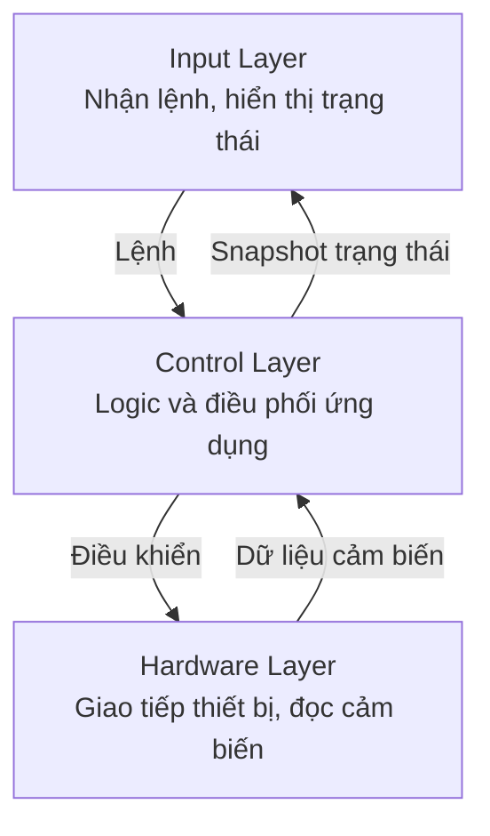

# Hierarchical Layered Architecture

## 1. Introduction

**Hierarchical Layered Architecture** chia module thành các layer có trách nhiệm
rõ ràng. Layer nhận yêu cầu chỉ gọi API của layer điều phối; layer điều phối
thực hiện logic ứng dụng; layer phần cứng giao tiếp với thiết bị
và đọc cảm biến. Trạng thái ứng dụng trả về đi qua
**Read-only Snapshot** của controller.
Nhờ vậy, thêm một giao diện hoặc chế độ hoạt động không tạo thêm đường điều khiển thiết bị
riêng và không buộc layer nhận yêu cầu biết chi tiết của board này.

Các layer được tổ chức bằng các module trong `components/`; `main/` khởi tạo hệ thống.

## 2. Architecture Diagram



Sơ đồ thể hiện nguyên tắc phân lớp, áp dụng theo chức năng của từng dự án.

## 3. Source Structure

```text
project/
├── CMakeLists.txt
├── main/                      # Khởi tạo và kết nối các module
│   ├── main.c
│   └── CMakeLists.txt
├── components/
│   ├── input_adapter/         # Input: nhận lệnh, trả trạng thái
│   ├── controller/            # Control: xử lý logic, điều phối
│   └── device_driver/         # Hardware: giao tiếp thiết bị/cảm biến
├── config/                    # Cấu hình dự án và phần cứng
├── docs/                      # Tài liệu
└── README.md
```

Tên module trong cây là ví dụ; đặt tên theo chức năng thực tế (như `web_server`, `motor_controller`, `encoder`). Mỗi module dùng cấu trúc:

```text
module_name/
├── CMakeLists.txt
├── include/module_name.h      # API công khai
└── module_name.c              # Triển khai nội bộ
```

- Input gọi API của Control; Control gọi Hardware. Input không điều khiển trực tiếp Hardware.
- Hardware không gọi ngược logic Control; Control đọc dữ liệu cảm biến và cung cấp snapshot cho Input.
- `main/` chỉ khởi tạo, kết nối module; không chứa logic điều khiển hay xử lý GPIO.

## 4. Các component RobotCar hiện tại

```text
components/
├── motor_driver/
│   ├── CMakeLists.txt
│   ├── include/motor_driver.h
│   └── motor_driver.cc
├── wheel_encoder/
│   ├── CMakeLists.txt
│   ├── include/wheel_encoder.h
│   └── wheel_encoder.cc
├── imu/
│   ├── CMakeLists.txt
│   ├── include/imu.h
│   └── imu.cc
├── ultrasonic_sensor/
│   ├── CMakeLists.txt
│   ├── include/ultrasonic_sensor.h
│   └── ultrasonic_sensor.cc
└── motor_controller/
    ├── CMakeLists.txt
    ├── include/
    │   ├── motor_controller.h
    │   ├── commands/
    │   └── domain/
    ├── commands/
    ├── controller_internal.h
    ├── motor_controller.cc
    └── ...                       # Motor output, PI/PD, odometry, safety
```

| Component | Trách nhiệm |
| --- | --- |
| `motor_driver` | GPIO/LEDC điều khiển bốn motor qua hai L298N |
| `wheel_encoder` | FC-03, PCNT, số xung, RPM và quãng đường bánh xe |
| `imu` | MPU6050/MPU6500 tương thích, hiệu chỉnh gyro Z và tích phân heading |
| `ultrasonic_sensor` | HC-SR04, lọc khoảng cách và giữ servo ở vị trí giữa |
| `motor_controller` | Command, safety, phiên điều khiển, PI/PD, odometry/EKF và snapshot |

Board khởi tạo tại `main/boards/bread-compact-wifi-lcd/robot/robot_board.cc`:

- Đọc pin, calibration và tuning từ `config.h`/Kconfig hiện có, giữ các kiểm tra
  `static_assert`, rồi truyền bản sao cấu hình vào các component.
- Cung cấp callback kiểm tra trạng thái ứng dụng, schedule lên main task và phát
  âm báo. `motor_controller` không include `application.h`, assets hay board config.
- Khởi tạo controller trước khi đăng ký MCP/Telegram và callback của giao diện.
  Task monitor encoder, heading và odometry thuộc phía board; sensor driver không
  đọc ngược snapshot từ controller.

Web, MCP, Telegram và serialization hiện vẫn ở board và dùng API công khai của
`motor_controller`. Các tên hàm/struct `L298n*`, `Fc03*`, `Mpu6050*` được giữ để
không đổi contract hiện tại. `InitializeL298nController()` nhận thêm cấu hình và
phải được gọi trước các API runtime. Các struct snapshot và dữ liệu JSON giữ nguyên.

Chiều phụ thuộc: Input → `motor_controller` → các driver. Không có dependency
từ component về `main`. `commands` và `domain` thuộc `motor_controller` vì chúng
là logic điều khiển, không phải component phần cứng độc lập.

Giữ nguyên board/OTA identity, pin, LEDC timer/channel, chu kỳ task/timer, gains,
calibration, timeout và Kconfig keys. Khi tắt FC-03, cấu hình encoder có
`enabled=false`; driver không cấp phát PCNT và controller không bật speed PI.
Code PCNT được guard bằng capability `SOC_PCNT_SUPPORTED`.
