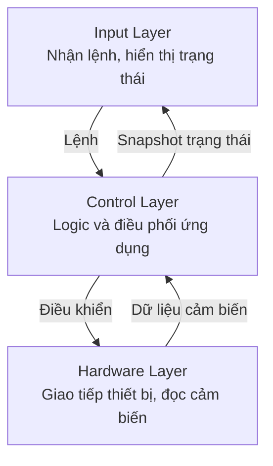

# Hierarchical Layered Architecture

## 1. Introduction

**Hierarchical Layered Architecture** chia module thành các layer có trách nhiệm
rõ ràng. Layer nhận yêu cầu chỉ gọi API của layer điều phối; layer điều phối
thực hiện logic ứng dụng; layer phần cứng giao tiếp với thiết bị
và đọc cảm biến. Trạng thái ứng dụng trả về đi qua
**Read-only Snapshot** của controller.
Nhờ vậy, thêm một giao diện hoặc chế độ hoạt động không tạo thêm đường điều khiển thiết bị
riêng và không buộc layer nhận yêu cầu biết chi tiết của board này.

Các layer được tổ chức bằng các module trong `components/`; `main/` khởi tạo hệ thống.

## 2. Architecture Diagram



Sơ đồ thể hiện nguyên tắc phân lớp, áp dụng theo chức năng của từng dự án.

## 3. Source Structure

```text
project/
├── CMakeLists.txt
├── main/                      # Khởi tạo và kết nối các module
│   ├── main.c
│   └── CMakeLists.txt
├── components/
│   ├── input_adapter/         # Input: nhận lệnh, trả trạng thái
│   ├── controller/            # Control: xử lý logic, điều phối
│   └── device_driver/         # Hardware: giao tiếp thiết bị/cảm biến
├── config/                    # Cấu hình dự án và phần cứng
├── docs/                      # Tài liệu
└── README.md
```

Tên module trong cây là ví dụ; đặt tên theo chức năng thực tế (như `web_server`, `motor_controller`, `encoder`). Mỗi module dùng cấu trúc:

```text
module_name/
├── CMakeLists.txt
├── include/module_name.h      # API công khai
└── module_name.c              # Triển khai nội bộ
```

- Input gọi API của Control; Control gọi Hardware. Input không điều khiển trực tiếp Hardware.
- Hardware không gọi ngược logic Control; Control đọc dữ liệu cảm biến và cung cấp snapshot cho Input.
- `main/` chỉ khởi tạo, kết nối module; không chứa logic điều khiển hay xử lý GPIO.
