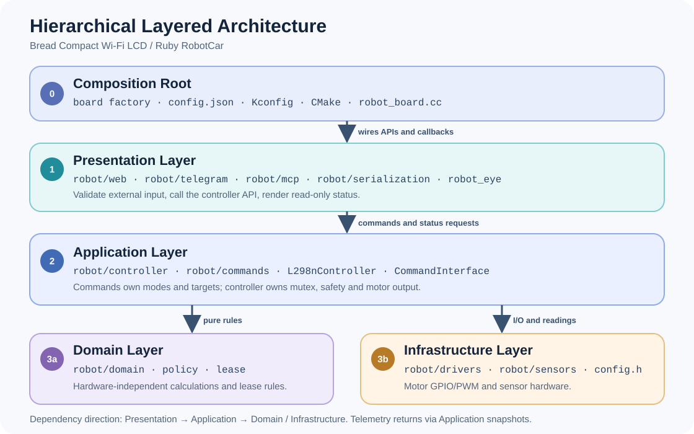

# Hierarchical Layered Architecture — Ruby RobotCar

## 1. Introduction

**Hierarchical Layered Architecture** chia module thành các layer có trách nhiệm
rõ ràng. Layer nhận yêu cầu chỉ gọi API của layer điều phối; layer điều phối quyết
định chế độ, an toàn và mục tiêu chuyển động; layer phần cứng thực hiện GPIO/PWM
và đọc cảm biến. Dữ liệu trả về đi qua **Read-only Snapshot** của controller.
Nhờ vậy, thêm một giao diện hoặc chế độ lái không tạo thêm đường điều khiển motor
riêng và không buộc core XiaoZhi biết chi tiết của board này.

Tài liệu này là quy ước cho `main/boards/bread-compact-wifi-lcd/`.

**Dependency Rule:** `Presentation → Application → Domain / Infrastructure`.
`Domain Layer` không phụ thuộc phần cứng. `Infrastructure Layer` không gọi ngược
lên controller hoặc giao diện. `Composition Root` nối các thành phần khi khởi tạo;
core XiaoZhi tiếp tục dùng giao diện `Board` chung.

## 2. Architecture Diagram



Mũi tên thể hiện chiều **gọi và phụ thuộc**. Sensor readings đi lên qua controller;
Web, MCP và màn hình đọc trạng thái xe từ snapshot hoặc callback chỉ đọc.
Telegram chỉ xem trạng thái hệ thống/mạng và gửi thông báo, không điều khiển xe.
Không có đường gọi trực tiếp từ `Presentation Layer` xuống GPIO/PWM.

## 3. Source Structure

```text
main/boards/bread-compact-wifi-lcd/
├── config.json                 Composition Root: board variant và chip target
├── config.h                    Board configuration: chân và hiệu chuẩn phần cứng
├── compact_wifi_board_lcd.cc   Composition Root: một DECLARE_BOARD, LCD/audio/network
├── robot/
│   ├── robot_board.{h,cc}      Composition Root: nối controller, adapter, display
│   ├── web/                    Presentation Layer: HTTP API và web_page.h
│   ├── telegram/               Presentation Layer: bot, lệnh và thông báo
│   ├── mcp/                    Presentation Layer: device-side MCP tools
│   ├── serialization/          Presentation Layer: encoder → JSON
│   ├── commands/               Application Layer: chế độ và mục tiêu hai bánh
│   │   ├── command_interface.* Chọn chế độ, request và trạng thái chung
│   │   ├── motion_goal_command.* Đích quãng đường và góc xoay
│   │   └── wheel_command.h     Kiểu dữ liệu mục tiêu hai bánh
│   ├── controller/             Application Layer: thực thi và an toàn
│   │   ├── l298n_controller.*  Public API, khởi tạo và Read-only Snapshot
│   │   ├── web_control.cc      Chuyển Web command thành lệnh controller
│   │   ├── motion_executor.cc  Timer, deadline, chuyển động và dừng
│   │   ├── motor_output.cc     Chuyển wheel targets sang motor driver
│   │   ├── speed_control.cc    Heading PD và phản hồi Speed PI từ encoder
│   │   ├── heading_pd.h        Thuật toán PD thuần, tạo mục tiêu RPM hai bên
│   │   └── speed_pi.h          Thuật toán PI thuần, hiện đặt cạnh controller
│   ├── domain/                 Domain Layer: motion_policy, WebControlSession,
│   │                           Navigator, Odometry và PoseEKF
│   ├── drivers/                Infrastructure Layer: L298N GPIO/LEDC
│   └── sensors/                Infrastructure Layer: FC-03, HC-SR04, MPU6050
└── robot_eye/                  Presentation Layer: LVGL display và animation
```

Tài liệu riêng của board nằm tại `docs/` ở gốc dự án.

`main/CMakeLists.txt` chọn source có điều kiện. Khi thêm board hoặc variant mới,
phải cập nhật đủ `config.json → scripts/build.py → main/Kconfig.projbuild →
main/CMakeLists.txt → board source/config.h`; giữ đúng một `DECLARE_BOARD` và
danh tính board riêng để không ảnh hưởng OTA của board cũ.

### Quyền sở hữu của từng layer

| Layer                    | Được làm                                                                                                                         | Không được làm                                                          |
| ------------------------ | -------------------------------------------------------------------------------------------------------------------------------- | ----------------------------------------------------------------------- |
| **Presentation Layer**   | Validate input; Web/MCP gọi `l298n_controller.h`; Telegram xử lý trạng thái hệ thống và thông báo.                                | Include `controller_internal.h`; tự đặt GPIO/PWM; tự đổi `CommandMode`. |
| **Application Layer**    | Khóa mutex, cấp/thu quyền, chọn mode, kiểm tra `Application` state, deadline, sensor freshness, lỗi; gọi driver và tạo snapshot. | Đưa HTTP, Telegram hoặc LVGL vào logic điều khiển motor.                |
| **Domain Layer**         | Tính toán thuần từ tham số được truyền vào: joystick mixing, ngưỡng, token/sequence/deadline.                                    | Dùng ESP-IDF driver, `config.h`, singleton mạng hoặc `Application`.     |
| **Infrastructure Layer** | Điều khiển motor, lấy mẫu cảm biến và báo lỗi/telemetry.                                                                         | Parse request; chọn nguồn lệnh, mode hoặc thời điểm cho phép xe chạy.   |
| **Composition Root**     | Tạo board, khởi tạo module, nối callback và chọn source.                                                                         | Chứa vòng điều khiển motor hoặc luật chuyển mode.                       |

`robot_eye/` nhận Wi-Fi, nhiệt độ và trạng thái xe qua callback; màn hình không
include motor controller. `robot/serialization/` chỉ chuyển dữ liệu sang JSON,
không lấy mẫu encoder. Web và MCP có thể khác nhau về định dạng request, nhưng
cùng dùng API controller và cùng tuân theo một đường dừng motor.

## 4. Command Interface

`CommandInterface` chọn một chế độ tại một thời điểm: `kIdle`, `kManual` (HUD),
`kDistanceDrive` (tiến/lùi theo quãng đường), `kAngleTurn` (xoay theo góc) hoặc
`kNavigate` (đi đến tọa độ tương đối). `CommandInterface` giữ mục tiêu hai bánh
khi lái thủ công; `motion_goal_command.*` giữ đích quãng đường/góc;
`domain/navigator.h` tính mục tiêu điều hướng. Controller nhận `CommandRequest`,
kiểm tra quyền và cảm biến,
rồi lấy mục tiêu hai bánh và điều kiện kết thúc từ `CommandInterface`.

### Năm API hướng và dừng dùng chung

`controller/l298n_controller.h` là điểm gọi chuyển động của Web, MCP
và tính năng mới. Có đúng năm API hướng/dừng:

| Chức năng | API |
| --- | --- |
| Tiến | `MoveL298nForward(L298nLinearRequest)` |
| Lùi | `MoveL298nBackward(L298nLinearRequest)` |
| Xoay trái | `TurnL298nLeft(L298nTurnRequest)` |
| Xoay phải | `TurnL298nRight(L298nTurnRequest)` |
| Dừng | `StopL298nMotor(&web_request)` hoặc `StopL298nMotor()` |

`L298nLinearRequest` nhận `DistanceDriveRequest` hoặc `L298nWebDriveRequest`;
`L298nTurnRequest` nhận `AngleTurnRequest` hoặc `L298nWebDriveRequest`. Với
request theo mục tiêu, bốn hàm hướng nhận **độ lớn dương**: quãng đường 5–1000 cm,
góc 5–180°. Controller tự đặt dấu theo hướng. Tốc độ `0` chọn mức mặc định của board
(tiến/lùi) hoặc tốc độ xoay tự động. Lệnh bắt đầu bất đồng bộ; xem
`GetL298nMotorStatus().command` để biết hoàn thành hay lỗi trước khi gửi bước tiếp.

HUD dùng `L298nWebDriveRequest` sau `BeginL298nWebControl()`; mỗi lệnh mang
session, sequence và tốc độ để gia hạn phiên 600 ms. Web chọn một trong bốn hướng
từ nút hoặc trục joystick; controller dùng `JoystickMotion()` và `MixJoystick()`
để trộn mục tiêu hai bánh. `StopL298nMotor(&web_request)` chỉ dừng bánh và giữ
phiên; `StopL298nMotor()` dừng khẩn và hủy phiên;
`ReleaseL298nWebControl()` trả phiên. Không dùng request theo mục tiêu để thay
lệnh giữ nút HUD.

Bốn API hướng đi qua một controller và đường `ApplyCommandLocked()` → Speed PI/PWM
→ motor driver; API dừng dùng `StopLocked()` để ngắt motor. Speed PI cân tốc độ
hai bánh khi FC-03 được cấu hình. Các lệnh theo
quãng đường/góc còn dùng Heading PD và IMU để giữ hướng hoặc đạt góc; HUD không
tự giữ một góc cố định khi người dùng đang điều khiển joystick. Controller giữ
kiểm tra phiên, pose, cảm biến, thời hạn và lỗi motor theo từng loại request.

Tính năng mới dùng năm API này cho chuyển động đã có và đặt logic phối hợp ở
`commands/` hoặc adapter thích hợp; không tạo thêm hàm GPIO/PWM hay đường điều
khiển motor riêng. Nếu cần mode mới hoặc đổi hướng trong lúc chạy, thêm luật
chuyển mode và cơ chế đổi hướng an toàn dùng chung trong `CommandInterface` và
controller trước khi sử dụng, thay vì gọi chồng hai lệnh đang hoạt động. Chế độ
điều hướng nhiều bước vẫn dùng `StartL298nCommand(NavigateRequest)` để giữ một
mode xuyên suốt; nó dùng cùng đường hiệu chỉnh và xuất motor của controller.

Luồng chung: **Adapter → Controller → Command Interface → Heading PD (khi giữ hướng) → Speed PI/PWM → Motor Driver**.
`kManual` dùng Speed PI khi đã cấu hình; các lệnh theo mục tiêu yêu cầu Speed PI
và heading hợp lệ. Với lệnh xoay theo góc, controller dừng khi góc và tốc độ quay
ổn định trong ngưỡng cấu hình; nếu quá thời gian, lệnh báo lỗi.

## 5. Control Flow and Safety

Ví dụ khi người dùng kéo joystick trên Web:

1. Web chọn một trong bốn API hướng và gửi session, sequence, tốc độ đến Controller.
2. Controller kiểm tra phiên điều khiển còn hợp lệ; `CommandInterface` giữ tốc độ
   yêu cầu cho hai bánh.
3. Speed PI điều chỉnh tốc độ theo FC-03 nếu đã cấu hình. Motor Driver xuất
   GPIO/PWM để xe chạy.
4. Web, MCP và màn hình chỉ đọc trạng thái xe để hiển thị.

Các quy tắc dừng phải luôn được giữ:

- Web không gửi lệnh hợp lệ trong **600 ms**, hoặc mất Wi-Fi: dừng motor và hủy
  phiên điều khiển Web.
- Lệnh dừng khẩn dừng motor và hủy phiên. Nút Stop trong phiên Web chỉ dừng bánh;
  phiên vẫn còn để người dùng tiếp tục lái.
- `kDistanceDrive` và `kNavigate` nhận thời hạn 1–120 giây trong request;
  `kAngleTurn` có hạn 5 giây. Các lệnh theo mục tiêu cần Wi-Fi và dừng khi mất Wi-Fi.
- `kDistanceDrive` cần FC-03, IMU và pose hợp lệ. HC-SR04 chỉ cảnh báo trong HUD
  và dừng `kNavigate` khi phát hiện vật cản; nó không dừng lệnh đi theo quãng đường.
- Lỗi xuất motor được ghi lại và xe không tự chạy lại.

Controller tự kiểm tra thời hạn, không phụ thuộc việc trình duyệt còn mở. Callback
từ Wi-Fi hoặc cảm biến có thể chạy ở task khác; nếu cần đổi trạng thái
`Application`, dùng `Application::Schedule()`. Không chặn timer motor hoặc audio
task bằng xử lý mạng hay công việc nặng.

## 6. Change Checklist

Khi thêm mode hoặc đầu vào mới:

1. Ghi rõ nguồn yêu cầu, điều kiện vào/thoát, timeout, mất mạng, thiếu sensor,
   lỗi và stop.
2. Dùng năm API hướng/dừng trong `l298n_controller.h` cho chuyển động sẵn có.
   Chọn request theo mục tiêu hoặc HUD đúng với thời hạn và cách dừng cần thiết.
3. Thêm transition vào `CommandInterface` nếu có mode mới. Logic thuần đặt trong
   `Domain Layer`; quyền cho phép chạy vẫn thuộc controller. Giữ đường
   `ApplyCommandLocked` → Speed PI/PWM → driver; không gọi driver từ Web,
   Telegram, MCP, `robot_eye` hay sensor task.
4. Cập nhật snapshot, adapter, cấu hình source và tài liệu nếu contract đổi.
5. Kiểm tra chuyển mode, hết hạn, dừng, mất mạng, lỗi sensor/PI và mọi giao diện
   bị ảnh hưởng. Trước khi phát hành, build variant liên quan và thử dừng motor
   trên phần cứng; build không thay thế kiểm tra trên xe.

Không đổi chân của board hiện có để hỗ trợ phần cứng khác. Tạo board hoặc release
variant có danh tính riêng theo [hướng dẫn board](custom-board.md)
ở gốc dự án.
