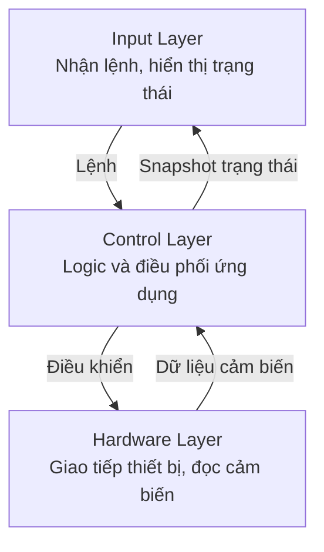

# Hierarchical Layered Architecture

## 1. Introduction

**Hierarchical Layered Architecture** chia module thành các layer có trách nhiệm
rõ ràng. Layer nhận yêu cầu chỉ gọi API của layer điều phối; layer điều phối
thực hiện logic ứng dụng; layer phần cứng giao tiếp với thiết bị
và đọc cảm biến. Trạng thái ứng dụng trả về đi qua
**Read-only Snapshot** của controller.
Nhờ vậy, thêm một giao diện hoặc chế độ hoạt động không tạo thêm đường điều khiển thiết bị
riêng và không buộc layer nhận yêu cầu biết chi tiết của board này.

Các layer được tổ chức bằng các module trong `components/`; `main/` khởi tạo hệ thống.

## 2. Architecture Diagram



Sơ đồ thể hiện nguyên tắc phân lớp, áp dụng theo chức năng của từng dự án.

## 3. Source Structure

```text
project/
├── CMakeLists.txt
├── main/                      # Khởi tạo và kết nối các module
│   ├── main.c
│   └── CMakeLists.txt
├── components/
│   ├── input_adapter/         # Input: nhận lệnh, trả trạng thái
│   ├── controller/            # Control: xử lý logic, điều phối
│   └── device_driver/         # Hardware: giao tiếp thiết bị/cảm biến
├── config/                    # Cấu hình dự án và phần cứng
├── docs/                      # Tài liệu
└── README.md
```

Tên module trong cây là ví dụ; đặt tên theo chức năng thực tế (như `web_server`, `motor_controller`, `encoder`). Mỗi module dùng cấu trúc:

```text
module_name/
├── CMakeLists.txt
├── include/module_name.h      # API công khai
└── module_name.c              # Triển khai nội bộ
```

- Input gọi API của Control; Control gọi Hardware. Input không điều khiển trực tiếp Hardware.
- Hardware không gọi ngược logic Control; Control đọc dữ liệu cảm biến và cung cấp snapshot cho Input.
- `main/` chỉ khởi tạo, kết nối module; không chứa logic điều khiển hay xử lý GPIO.

## 4. Các component RobotCar hiện tại

```text
components/
├── motor_driver/
│   ├── CMakeLists.txt
│   ├── include/motor_driver.h
│   └── motor_driver.cc
├── wheel_encoder/
│   ├── CMakeLists.txt
│   ├── include/wheel_encoder.h
│   └── wheel_encoder.cc
├── imu/
│   ├── CMakeLists.txt
│   ├── include/imu.h
│   └── imu.cc
├── ultrasonic_sensor/
│   ├── CMakeLists.txt
│   ├── include/ultrasonic_sensor.h
│   └── ultrasonic_sensor.cc
└── motor_controller/
    ├── CMakeLists.txt
    ├── include/
    │   ├── motor_controller.h
    │   ├── commands/
    │   └── domain/
    ├── commands/
    ├── controller_internal.h
    ├── motor_controller.cc
    └── ...                       # Motor output, PI/PD, odometry, safety
```

| Component | Trách nhiệm |
| --- | --- |
| `motor_driver` | GPIO/LEDC điều khiển bốn motor qua hai L298N |
| `wheel_encoder` | FC-03, PCNT, số xung, RPM và quãng đường bánh xe |
| `imu` | MPU6050/MPU6500 tương thích, hiệu chỉnh gyro Z và tích phân heading |
| `ultrasonic_sensor` | HC-SR04, lọc khoảng cách và giữ servo ở vị trí giữa |
| `motor_controller` | Command, safety, phiên điều khiển, PI/PD, odometry/EKF và snapshot |
| `settings` | Đọc/ghi NVS, giữ nguyên namespace, key và API `Settings` |
| `audio` | Codec, capture/playback, Opus, AFE, wake word và queue âm thanh |

`components/settings/` có `settings.cc` và `include/settings.h`.
`components/audio/` chứa implementation âm thanh, public header trong `include/`
và dependency audio được khai báo trong `CMakeLists.txt`/`idf_component.yml` riêng.
`Application` truyền codec và callback đọc asset vào `AudioService::Initialize()`;
component audio không include `Board`, `Application`, `Assets` hay `Protocol`.
`AudioStreamPacket` được khai báo tại `components/audio/include/audio_types.h`
để audio và hai transport dùng chung. Xem [thiết kế audio](../components/audio/README.md).

Board khởi tạo tại `main/boards/robot/robot_board.cc`:

- Đọc pin, calibration và tuning từ `config/board_config.h`/Kconfig hiện có, giữ các kiểm tra
  `static_assert`, rồi truyền bản sao cấu hình vào các component.
- Cung cấp callback kiểm tra trạng thái ứng dụng, schedule lên main task và phát
  âm báo. `motor_controller` không include `application.h`, assets hay board config.
- Khởi tạo controller trước khi đăng ký MCP/Telegram và nhận lệnh qua các adapter.
  Task monitor encoder, heading và odometry thuộc phía board; sensor driver không
  đọc ngược snapshot từ controller.

Web, MCP, Telegram và serialization hiện vẫn ở board và dùng API công khai của
`motor_controller`. Các tên hàm/struct `L298n*`, `Fc03*`, `Mpu6050*` được giữ để
không đổi contract hiện tại. `InitializeL298nController()` nhận thêm cấu hình và
phải được gọi trước các API runtime. Các struct snapshot và dữ liệu JSON giữ nguyên.

Chiều phụ thuộc: Input → `motor_controller` → các driver. Không có dependency
từ component về `main`. `commands` và `domain` thuộc `motor_controller` vì chúng
là logic điều khiển, không phải component phần cứng độc lập.

Giữ nguyên board/OTA identity, pin, LEDC timer/channel, chu kỳ task/timer, gains,
calibration, timeout và Kconfig keys. Khi tắt FC-03, cấu hình encoder có
`enabled=false`; driver không cấp phát PCNT và controller không bật speed PI.
Code PCNT được guard bằng capability `SOC_PCNT_SUPPORTED`.

## 5. Cấu hình dự án

Firmware chỉ dùng một board, nên cấu hình nằm trực tiếp trong `config/`:

```text
config/
├── build_config.json
├── board_config.h
├── audio_config.h
├── robot_hardware_config.h
└── motion_control_config.h
```

| File | Nội dung |
| --- | --- |
| `build_config.json` | Target ESP32-S3, bản build duy nhất và type/name OTA hiện có |
| `board_config.h` | Header tổng hợp và pin button/LED/lamp |
| `audio_config.h` | Sample rate, chân I2S và microphone debug |
| `robot_hardware_config.h` | Pin motor, IMU, ultrasonic/servo; pin, calibration và filter/coast của encoder |
| `motion_control_config.h` | Speed PI, heading PD, distance drive, odometry/EKF và debug điều khiển |

Code khởi tạo board include `board_config.h`. CMake chỉ cung cấp đường dẫn
`config/` qua `PRIV_INCLUDE_DIRS` của `main`; các component tiếp tục nhận
struct cấu hình từ board, không include các header này.

Tên macro, giá trị và các điều kiện Kconfig được giữ nguyên khi chia file.
`config/build_config.json` cung cấp target và board/OTA identity cho CMake và
build script. `sdkconfig` tiếp tục do ESP-IDF quản lý.


## 6. Một board và một bản build

```text
main/boards/
├── common/
├── robot_car_board.cc
└── robot/
```

`RobotCarBoard` trong `robot_car_board.cc` là factory duy nhất được đăng ký bằng
`DECLARE_BOARD`. CMake dùng source này trực tiếp, không chọn thư mục board.
`robot/` chứa phần khởi tạo và các adapter còn lại. Firmware không dùng màn hình;
`RobotCarBoard` kế thừa `Board::GetDisplay()` để cung cấp `NoDisplay` và
`GetBacklight()` mặc định trả về `nullptr`.

Lệnh build duy nhất là `python scripts/build.py`; không truyền tên board hoặc
`--name`. Các tùy chọn ngôn ngữ, wake word, build options và đóng gói vẫn được giữ.
Build script đọc `config/build_config.json` và yêu cầu đúng một build entry cho
target `esp32s3`.

`BOARD_TYPE` và `BOARD_NAME` tiếp tục có giá trị `bread-compact-wifi-lcd` để
giữ nhận diện Xiaozhi/OTA. Chúng được đọc từ metadata, không suy ra từ đường dẫn
source. Các key Kconfig `CONFIG_BREAD_COMPACT_WIFI_LCD_*` và
`CONFIG_BOARD_TYPE_BREAD_COMPACT_WIFI_LCD` được giữ để tương thích cấu hình hiện tại;
cờ board là nội bộ, không còn mục chọn board trong menuconfig.


## 7. Firmware không dùng màn hình

`InitializeRobotBoard()` không nhận tham số display. Board không khởi tạo
SPI/TFT/backlight và không đăng ký callback của RobotEye. Các file RobotEye,
`config/display_config.h` và tùy chọn `BREAD_COMPACT_WIFI_LCD_DISPLAY` đã được gỡ.

Lớp `Display`/`NoDisplay` của framework được giữ để các lời gọi từ `Application`,
Wi-Fi, assets và MCP tiếp tục có đối tượng hợp lệ. Source/dependency display dùng
chung vẫn phục vụ lớp framework này; việc gỡ RobotEye không thay đổi chúng.

Pin, timer/channel PWM của motor và servo, cấu hình audio, API điều khiển và
`BOARD_TYPE`/`BOARD_NAME` được giữ nguyên.
