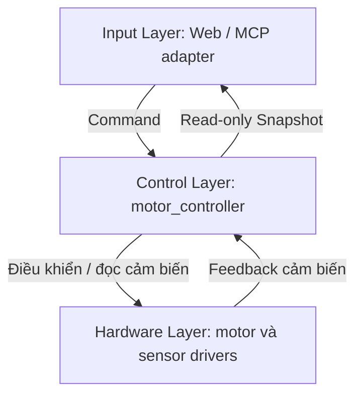

# Ruby RobotCar — Hierarchical Layered Architecture

## 1. Kiến trúc Low-level Controller

Tầng low-level trên ESP32-S3 được xây dựng theo **Hierarchical Layered Architecture**, gồm ba layer:

| Layer | Module | Trách nhiệm |
| --- | --- | --- |
| **Input** | `components/web_server/`, `main/robot/mcp/` | Nhận/kiểm tra request, chuyển thành command, trả trạng thái |
| **Control** | `components/motor_controller/` | Điều phối command, Speed PI, Heading PD, motion goals, odometry/EKF và safety |
| **Hardware** | `components/motor_driver/`, `components/wheel_encoder/`, `components/imu/`, `components/ultrasonic_sensor/` | GPIO/PWM, đọc cảm biến và cung cấp feedback |

### Quy tắc phân lớp

- Phụ thuộc theo chiều **Input → Control → Hardware**. Input không gọi driver trực tiếp.
- Hardware cung cấp dữ liệu qua API/callback; không phụ thuộc logic Control hoặc Input.
- Control là nơi duy nhất quyết định chuyển động và safety; Input đọc trạng thái qua **Read-only Snapshot**.
- Thêm nguồn lệnh mới qua adapter của Input, dùng lại đường điều khiển chung.

## 2. Khởi tạo và tích hợp ứng dụng

- `main/robot_car_board.cc` là factory duy nhất; `main/robot/robot_board.cc` khởi tạo robot, truyền struct cấu hình từ `config/` và callback vào component.
- Component không phụ thuộc ngược vào `main/` hoặc `config/`. JSON dùng chung nằm ở `main/robot/serialization/`.
- `main/application.*`, `main/protocols/` và `components/audio/` hiện chứa flow trò chuyện kế thừa XiaoZhi. Callback thay đổi ứng dụng qua `Application::Schedule()` hoặc event bits; đổi state qua `SetDeviceState()`.

## 3. High-level Computer — kế hoạch

**Samsung Z Flip 5** là bộ não chính cho AI, hội thoại và quyết định/điều hướng cấp cao. Điện thoại gửi mục tiêu qua adapter Input, nhận telemetry/kết quả từ Control; ESP32 giữ control loop và safety.

Tầng high-level tự chọn model chạy trên điện thoại hoặc máy chủ tự quản lý. Có thể tái sử dụng flow XiaoZhi; không bắt buộc dùng dịch vụ Xiaozhi. Low-level không phụ thuộc model hay nhà cung cấp AI.

Giao thức điện thoại, quyền điều khiển và timeout chưa chốt. Hướng AI mở rộng trên kiến trúc low-level này sau khi controller đạt nghiệm thu.

Chi tiết: [board/build](custom-board.md) · [audio](../components/audio/README.md) · [yêu cầu và tiến độ](robot/ROBOT_4WD_REQUIREMENTS.md).
