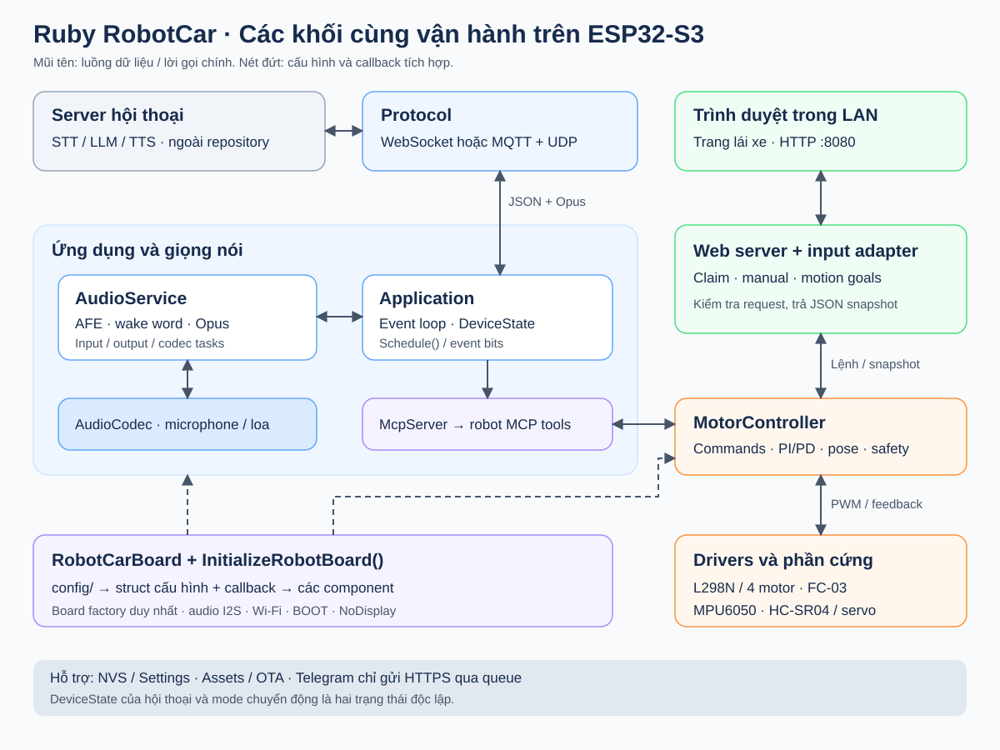
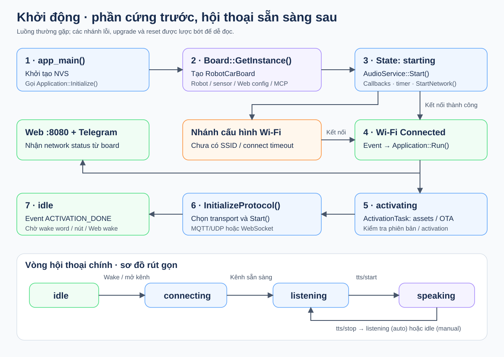
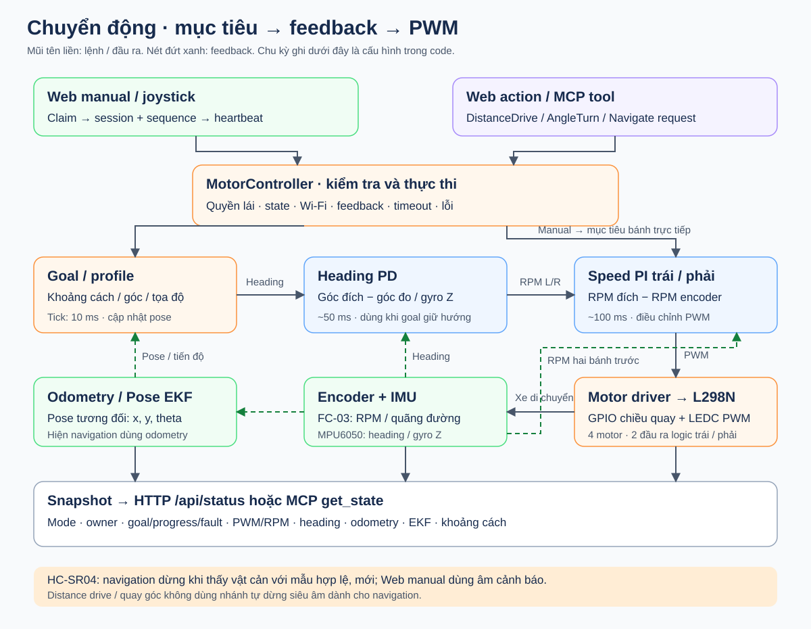

# Ruby RobotCar: đọc hiểu cách firmware vận hành

Tài liệu giải thích luồng chạy dựa trên source code hiện có, dành cho việc đọc và lần theo code trong VS Code. Các giá trị cấu hình bên dưới là giá trị trong source tại thời điểm viết; chúng không chứng minh phần cứng đã được hiệu chỉnh hay chạy đúng.

Mở Markdown Preview bằng **Ctrl+Shift+V** để xem tài liệu cùng sơ đồ. Các file SVG nằm trong [diagrams](diagrams/) và có thể mở riêng để phóng to.

## 1. Bức tranh tổng thể

ESP32-S3 đảm nhận hai nhóm công việc song song:

- **Trợ lý giọng nói:** thu âm, nhận wake word, gửi âm thanh lên server, nhận phản hồi và phát loa. Phần xử lý hội thoại phía server nằm ngoài repository này.
- **Điều khiển robot:** nhận lệnh từ Web hoặc MCP, điều khiển motor, đọc cảm biến và cập nhật vị trí tương đối. Các vòng điều khiển chạy trên ESP32.

`Application` điều phối hội thoại và vòng đời kết nối. `MotorController` quyết định chuyển động. `RobotCarBoard` và `InitializeRobotBoard()` nối các khối này với phần cứng bằng cấu hình và callback.

| Vị trí | Vai trò | Điểm nên đọc |
| --- | --- | --- |
| [main/main.cc](../main/main.cc) | Điểm vào firmware | `app_main()` |
| [main/application.cc](../main/application.cc) | Khởi tạo và xử lý sự kiện ứng dụng | `Initialize()`, `Run()`, `InitializeProtocol()` |
| [main/device_state_machine.cc](../main/device_state_machine.cc) | Kiểm tra chuyển trạng thái hợp lệ | `IsValidTransition()`, `TransitionTo()` |
| [main/robot_car_board.cc](../main/robot_car_board.cc) | Board cụ thể, nút BOOT, audio I2S, sự kiện Wi-Fi | `RobotCarBoard`, `DECLARE_BOARD(...)` |
| [main/robot/robot_board.cc](../main/robot/robot_board.cc) | Lắp ghép motor, Web, Telegram và robot MCP | `MakeMotorControllerConfig()`, `InitializeRobotBoard()` |
| [components/motor_controller](../components/motor_controller/) | Lệnh, feedback, safety, odometry và navigation | `StartCommand()`, `Tick()`, `Snapshot()` |
| [components/audio](../components/audio/) | Pipeline âm thanh và wake word | `AudioService`, `AfeAudioEngine` |
| [components/web_server](../components/web_server/) | Trang điều khiển và HTTP API nội bộ | `Claim()`, `Command()`, `Action()`, `Status()` |
| [main/robot/mcp/mcp_tools.cc](../main/robot/mcp/mcp_tools.cc) | Chuyển lời gọi tool thành lệnh robot | `RegisterL298nMcpTools()` |
| [main/protocols](../main/protocols/) | Giao tiếp server bằng WebSocket hoặc MQTT/UDP | `Protocol` và hai implementation |
| [config](../config/) | Chân kết nối, audio và tham số điều khiển | Ba header được include bởi `board_config.h` |

## 2. Từ cấp nguồn đến sẵn sàng

### Bước 1: ESP-IDF gọi `app_main()`

[main.cc](../main/main.cc) khởi tạo NVS, nơi lưu cấu hình bền vững như Wi-Fi. Nếu NVS báo hết trang hoặc phiên bản không tương thích, code xóa NVS rồi khởi tạo lại. Sau đó gọi `Application::Initialize()` và `Application::Run()`.

### Bước 2: Tạo board và hệ thống robot

Ngay đầu `Application::Initialize()`, `Board::GetInstance()` gọi factory `create_board()`. Factory này được tạo bởi duy nhất một `DECLARE_BOARD(RobotCarBoard)`.

Constructor của `RobotCarBoard` đăng ký nút BOOT và gọi `InitializeRobotBoard()`. Hàm này:

1. Tạo `MotorControllerConfig` từ các header trong `config/`.
2. Khởi tạo controller, encoder, IMU, timer điều khiển và cảm biến siêu âm.
3. Cung cấp callback đọc mạng, đánh thức hội thoại và thêm telemetry cho Web server.
4. Đăng ký MCP tools của robot.
5. Khởi tạo Telegram; nếu thành công thì đăng ký tool gửi Telegram.

Đây là **composition root**: nơi ghép các component với nhau. Component nhận struct cấu hình/callback, không tự include cấu hình board từ `config/`.

### Bước 3: Khởi tạo audio và đăng ký sự kiện

`Application` chuyển sang `starting`, lấy codec từ board, gọi `AudioService::Initialize()` và `Start()`. Sau đó đăng ký callback audio, listener trạng thái, clock timer, MCP tools chung và callback mạng.

Board kế thừa `NoDisplay`, `NoLed`; `GetBacklight()` trả `nullptr`. Vì vậy các lời gọi cập nhật giao diện trong framework không đồng nghĩa xe có màn hình hoặc LED. Tên `bread-compact-wifi-lcd` được giữ làm identity OTA, không mô tả phần cứng hiển thị hiện tại.

### Bước 4: Kết nối Wi-Fi, rồi khởi tạo hội thoại

`board.StartNetwork()` bắt đầu kết nối bằng cấu hình đã lưu. Chưa có SSID thì vào chế độ cấu hình Wi-Fi; kết nối không thành công trong thời hạn cũng có đường vào chế độ này. Board còn tạo task phát lời chào sau khoảng 1,5 giây, không chờ Wi-Fi thành công.

Khi có sự kiện `Connected`, callback board gọi `UpdateRobotNetwork(true)`: Web server bắt đầu phục vụ ở **`http://<IP-của-xe>:8080`**, Telegram nhận trạng thái có mạng. Đồng thời, `Application` nhận event kết nối và tạo `ActivationTask`.

`ActivationTask` lần lượt kiểm tra assets, kiểm tra firmware/activation qua OTA, rồi `InitializeProtocol()`. Nếu có cấu hình MQTT thì chọn `MqttProtocol`; nếu không, có cấu hình WebSocket thì chọn `WebsocketProtocol`; không có cả hai thì thử MQTT mặc định. Task báo hoàn tất về main loop để chuyển sang `idle`.

**Hệ quả:** Web control được khởi động theo Wi-Fi, còn việc chuẩn bị hội thoại có thêm bước OTA/activation và protocol. Hai đường sẵn sàng này không phải một bước duy nhất.

Nguồn: [board.h](../main/common/board.h), [wifi_board.cc](../main/common/wifi_board.cc), [application.cc](../main/application.cc), [robot_board.cc](../main/robot/robot_board.cc).

## 3. Vòng lặp chính và cách các task phối hợp

`Application::Run()` chờ FreeRTOS EventGroup bằng `xEventGroupWaitBits()`. Khi có event, nó xử lý các bit tương ứng: mạng, audio cần gửi, wake word, nút bấm, đổi trạng thái, playback đã hết hoặc công việc được lên lịch.

Có hai cách chuyển công việc về main task:

- **Event bit:** callback audio bật `MAIN_EVENT_SEND_AUDIO`; main loop lấy packet từ send queue rồi gọi `protocol_->SendAudio()`.
- **`Application::Schedule(callback)`:** đưa callback vào `main_tasks_`, bật `MAIN_EVENT_SCHEDULE`; main loop lấy các callback ra thực hiện.

Ví dụ, một callback mạng nhận JSON `tts/start` không trực tiếp xử lý toàn bộ quá trình phát tiếng. Nó lên lịch đổi state sang `speaking`; handler trạng thái sẽ cấu hình pipeline audio tương ứng.

| Ngữ cảnh chạy | Công việc chính |
| --- | --- |
| Main task / `Application::Run()` | Điều phối event, state, gửi audio, chạy callback đã Schedule |
| `ActivationTask` | Chuẩn bị assets, OTA/activation và protocol |
| Audio input / output / Opus tasks | Đọc microphone, encode/decode và phát PCM |
| AFE fetch task | Lấy kết quả pipeline xử lý tiếng nói và wake word |
| FreeRTOS `motor_control` task | Gọi `MotorController::Tick()` định kỳ |
| HTTP server task | Nhận và kiểm tra request Web, gọi API controller |
| Driver cảm biến và Telegram task | Thu thập feedback hoặc gửi HTTPS độc lập |

Các task cùng dùng controller được bảo vệ bằng mutex. Điều khiển motor không nằm trong vòng lặp hội thoại, nhưng vẫn nhận chính sách cho phép chuyển động qua callback của board.

## 4. Hội thoại giọng nói đi qua những đâu?

### Khi xe nghe

Luồng uplink trong [audio_service.cc](../components/audio/audio_service.cc):

`Microphone I2S → RobotCarAudioCodec → AudioInputTask → AfeAudioEngine → encode queue → OpusCodecTask → send queue → Application → Protocol → server`.

- Codec của board chuyển mẫu microphone I2S 32-bit thành PCM 16-bit. Cấu hình input hiện là **16 kHz**, output là **24 kHz**.
- `AfeAudioEngine` dùng một pipeline AFE chung cho wake word và xử lý giọng nói. WakeNet hoặc custom MultiNet được dùng tùy cấu hình/model; AEC/VAD cũng phụ thuộc chế độ đang bật.
- Wake word phát sinh event để `Application` mở kênh audio và bắt đầu listening. Có thể kích hoạt hội thoại từ nút BOOT hoặc action `wake` trên Web.
- PCM được nén Opus trước khi gửi. Firmware không chứa implementation LLM để tự hiểu mọi câu lệnh tại chỗ.

### Khi server trả lời

Luồng downlink:

`Server → Protocol → Application → decode queue → OpusCodecTask → playback queue → AudioOutputTask → codec I2S → MAX98357A / loa`.

JSON điều khiển và audio có vai trò khác nhau:

| Dữ liệu đến | Cách xử lý trong `InitializeProtocol()` |
| --- | --- |
| `tts/start` | Lên lịch chuyển sang `speaking` |
| Audio packet | Đưa vào decode queue khi đang `speaking` |
| `tts/stop` | Về `listening` hoặc `idle` tùy listening mode |
| `stt` | Ghi log/cập nhật nội dung nhận dạng qua display interface |
| `llm` | Cập nhật emotion qua display interface |
| `mcp` | Giao payload cho `McpServer::ParseMessage()` |
| `notify` | Phát nội dung từ `audio_url` và quản lý phụ đề qua `NotifyPlayer` |

Trong auto mode, nếu loa còn dữ liệu chưa phát hết khi quay lại `listening`, ứng dụng chờ event `MAIN_EVENT_PLAYBACK_DRAINED` trước khi bắt đầu thu giọng nói cho lượt tiếp theo.

`Protocol` là interface chung: WebSocket chở JSON và audio trên WebSocket; MQTT/UDP dùng MQTT cho signaling/JSON, UDP cho audio. Chỉ một implementation được chọn cho phiên ứng dụng, không phải cả hai cùng chạy hội thoại.

Chi tiết: [audio README](../components/audio/README.md), [WebSocket](xiaozhi/websocket.md), [MQTT/UDP](xiaozhi/mqtt-udp.md).

## 5. Một lệnh lái xe được thực hiện thế nào?

### Đường Web manual: người dùng giữ quyền lái

1. Trình duyệt tải [index.html](../components/web_server/web/index.html), CSS và [app.js](../components/web_server/web/js/app.js) từ ESP32.
2. `POST /api/claim` xin một session điều khiển.
3. `POST /api/command` gửi session, sequence tăng dần, hướng và tốc độ từ các nút HUD.
4. Controller kiểm tra token và thứ tự lệnh. Với HUD, JavaScript gửi heartbeat mỗi **150 ms**; mỗi lệnh hợp lệ gia hạn session thêm **600 ms**.
5. Controller chuyển hướng và tốc độ thành yêu cầu cho hai bên bánh qua đường điều khiển motor chung.
6. Session hết hạn, release hoặc mất Wi-Fi sẽ làm controller dừng và thu hồi quyền lái.

Session bảo vệ quyền điều khiển và chống lệnh cũ đến muộn. Lệnh `stop` trong manual dừng motor nhưng vẫn có thể giữ session; `release` thu hồi session. Global stop từ `/api/action` hoặc MCP dừng và giải phóng quyền Web.

### Đường goal: đi khoảng cách, quay góc hoặc đến tọa độ

Web `POST /api/action` và MCP tools tạo request như `DistanceDriveRequest`, `AngleTurnRequest`, `NavigateRequest`. Chúng đi vào `StartCommand()` qua các API `MoveL298nForward()`, `TurnL298nLeft()` hoặc `StartL298nCommand()`.

Trước khi bắt đầu, controller kiểm tra request, Wi-Fi, chính sách ứng dụng, quyền Web, command đang chạy, lỗi phần cứng và feedback cần thiết. Lệnh khoảng cách/navigation còn yêu cầu odometry hợp lệ và xe đứng yên. Không có hàng đợi goal để tự chạy nối tiếp: controller bận sẽ từ chối lệnh mới.

| Loại lệnh | Cách hoàn thành |
| --- | --- |
| Manual | Người dùng gửi lệnh mới, stop/release hoặc session hết hạn |
| `distance_drive` | Dùng quãng đường odometry, tăng/giảm tốc, dừng và chờ bánh ổn định |
| `angle_turn` | Dùng góc tương đối từ IMU, tự tính tốc độ, sửa quá góc và chờ bánh/gyro ổn định |
| `navigate` | Quay về phía đích khi cần, tiến đến tọa độ, giảm tốc và chờ dừng |

Các MCP tools hiện có: `self.motor.stop`, `self.motor.get_state`, `self.motor.reset_odometry`, `self.motor.move_distance`, `self.motor.rotate_angle`, `self.motor.navigate_to`.

Ví dụ với yêu cầu giọng nói “tiến 50 cm”: audio được gửi tới server; **nếu server gọi** `self.motor.move_distance` với `distance_cm=50`, adapter MCP tạo goal rồi ESP32 thực thi. Firmware không tự ánh xạ trực tiếp câu tiếng Việt đó thành PWM. Kết quả tool ngay sau khi nhận lệnh là snapshot lúc đó; cần đọc trạng thái tiếp để biết goal đã hoàn thành hay lỗi.

Web, MCP và lời gọi trực tiếp dùng chung `AngleTurnRequest`, chỉ gồm góc và nguồn yêu cầu, không truyền tốc độ. Với `StartL298nCommand()`, góc dương quay trái, âm quay phải; các wrapper `TurnL298nLeft()`/`TurnL298nRight()` nhận độ lớn góc dương rồi chọn chiều. Controller tính RPM từ sai số góc và gyro, giới hạn tốc độ tăng/giảm theo nhóm `HEADING_TURN_*` trong `config/motion_control_config.h`. Pha quay ban đầu của navigation cũng dùng profile này, không có mức tốc độ quay riêng.

Nếu vượt đích ngoài tolerance, controller ngắt PWM, chờ hết khoảng coasting và bánh/gyro ổn định, rồi đổi chiều để sửa góc. Quá trình chờ dùng timestamp trong vòng điều khiển, không chặn task. Hoàn thành khi góc nằm trong tolerance và cả hai bánh cùng gyro ổn định liên tục 150 ms. Lệnh quay góc vẫn có timeout tổng 5 giây, bao gồm thời gian sửa góc; navigation giữ timeout của request. `angle_turn_speed_percent` phản ánh mục tiêu hiện tại của profile và bằng 0 khi đang chờ đổi chiều hoặc đã dừng. Bù ma sát cũng tăng dần theo mục tiêu RPM lúc khởi động.

Nguồn: [web_server.cc](../components/web_server/web_server.cc), [mcp_tools.cc](../main/robot/mcp/mcp_tools.cc), [motor_controller.cc](../components/motor_controller/motor_controller.cc), [manual_control.cc](../components/motor_controller/manual/manual_control.cc).

## 6. Vòng feedback: từ mục tiêu đến PWM

`MotorController::Tick()` được task `motor_control` gọi với chu kỳ yêu cầu **10 ms**. Mỗi lượt cập nhật odometry, kiểm tra điều kiện dừng, cập nhật goal rồi điều chỉnh đầu ra. Đây là chu kỳ đặt trong code; độ trễ thực tế phụ thuộc runtime.

Ba tầng điều khiển cần phân biệt:

1. **Goal/profile:** xác định hướng và tốc độ cần thiết để đạt khoảng cách, góc hoặc tọa độ.
2. **Heading PD:** khi goal dùng heading, so sánh góc đích với góc IMU và dùng gyro Z để giảm dao động; điều chỉnh mục tiêu RPM trái/phải. Chu kỳ cập nhật thông thường là **50 ms**.
3. **Speed PI:** so RPM mục tiêu với RPM encoder, điều chỉnh PWM từng bên. Chu kỳ cập nhật thông thường là **100 ms**.

Đầu ra đi qua `motor_output.cc` tới `motor_driver`, rồi GPIO/LEDC điều khiển hai L298N. Bốn motor hoạt động theo hai bên: motor trước và sau bên trái nhận cùng đầu ra trái; tương tự bên phải. Chỉ hai bánh trước có encoder, nên feedback này đại diện cho từng bên, không đo riêng cả bốn motor.

`speed_percent` là yêu cầu/quy đổi tốc độ; trong đường PI nó không nhất thiết bằng PWM thực tế. Ví dụ cấu hình reference hiện tại là 200 RPM tại mức 100; yêu cầu 40 tương ứng khoảng 80 RPM trước các hiệu chỉnh heading/profile. PI có thể tăng hoặc giảm PWM để bám mục tiêu đó.

Nguồn: [motion_executor.cc](../components/motor_controller/control/motion_executor.cc), [speed_control.cc](../components/motor_controller/control/speed_control.cc), [motor_output.cc](../components/motor_controller/control/motor_output.cc), [controller_internal.h](../components/motor_controller/controller_internal.h).

## 7. Cảm biến, odometry và các giới hạn hiện tại

| Khối | Dữ liệu và công dụng |
| --- | --- |
| FC-03 | Đếm xung, tính RPM và quãng đường mỗi bên theo pulses/revolution và đường kính bánh |
| MPU6050 | Gyro Z và heading tương đối cho giữ hướng, quay góc và odometry |
| HC-SR04 | Gắn cố định hướng trước; callback khoảng cách cập nhật controller và yêu cầu âm báo khi phù hợp |
| `Odometry` | Tính pose `(x, y, theta)` từ quãng đường encoder và heading IMU |
| `PoseEkf` | Bộ ước lượng pose có covariance; cần track width hợp lệ để khởi tạo |

Hệ tọa độ odometry lấy gốc lúc khởi tạo/reset khi xe đứng yên: `+X` theo hướng ban đầu, góc dương quay trái. `navigate_to(x_cm, y_cm)` dùng tọa độ trong hệ gốc này, không phải một độ dời mới tính từ vị trí hiện tại cho mỗi lệnh.

Encoder FC-03 một kênh không tự đo được chiều quay; code suy chiều từ lệnh motor và khoảng coasting. Xung không biết chiều hoặc khoảng cách giữa hai mẫu vượt 100 ms có thể làm odometry mất hợp lệ. Sau khi pose đã mất hợp lệ, cần reset khi xe đứng yên và cảm biến sẵn sàng.

Cấu hình đáng chú ý trong [motion_control_config.h](../config/motion_control_config.h):

| Nhóm | Giá trị hiện tại | Ý nghĩa |
| --- | --- | --- |
| Speed PI | `KP=0.25`, `KI=0.50` cho hai bên | Hệ số điều chỉnh PWM từ sai số RPM |
| Heading PD | `KP=0.8`, `KD=0.15`, correction tối đa 35 RPM | Giữ hướng; giới hạn thực tế còn phụ thuộc tốc độ đang yêu cầu |
| Quay góc | Trần 200 RPM, KP 3 RPM/°, gia/giảm tốc 100/200 RPM/s | Tự tính tốc độ theo góc và gyro; trần không phải tốc độ cố định |
| Dừng/đảo chiều quay | Tolerance 2°, tối đa 8°/s và 3 RPM trong 150 ms | Đảo chiều còn chờ hết khoảng coasting; các hệ số cần tuning trên xe |
| Đi khoảng cách/navigation | Giới hạn tốc độ và gia/giảm tốc `DISTANCE_DRIVE_*` | Dùng chung cấu hình profile; tự giảm tốc khi gần đích |
| Dừng distance drive | Tolerance 20 mm, tối đa 3 RPM trong 300 ms | Điều kiện ổn định để kết thúc |
| Track width | `ODOMETRY_TRACK_WIDTH_MM=0.0` | Chưa cấu hình wheel heading/EKF; odometry dùng heading IMU vẫn có thể hợp lệ |
| Pose navigation | `NAVIGATION_USE_EKF=0` | Navigation dùng odometry thường |

Các thông số này cần đối chiếu và hiệu chỉnh trên xe thật. EKF không tạo vị trí tuyệt đối, không loại bỏ hoàn toàn trượt bánh hoặc gyro drift. Navigation hiện là đi tới điểm tương đối; chưa có SLAM, lập bản đồ hay lập đường tránh vật cản.

Nguồn: [odometry_control.cc](../components/motor_controller/odometry/odometry_control.cc), [odometry.h](../components/motor_controller/include/odometry/odometry.h), [pose_ekf.h](../components/motor_controller/include/odometry/pose_ekf.h), [navigator.h](../components/motor_controller/include/navigation/navigator.h), [robot_hardware_config.h](../config/robot_hardware_config.h).

## 8. Phải phân biệt trạng thái ứng dụng với trạng thái chuyển động

`DeviceState` mô tả vòng đời ứng dụng/hội thoại: `starting`, `wifi_configuring`, `activating`, `idle`, `connecting`, `listening`, `speaking`, cùng các nhánh `notifying`, `upgrading`, `audio_testing`, `fatal_error`.

Controller có mode riêng: `idle`, `manual`, `angle_turn`, `distance_drive`, `navigate`. Vì vậy **ứng dụng `idle` không có nghĩa motor đang đứng yên**; xe có thể được lái bằng Web khi trợ lý đang chờ. Ngược lại, `speaking` cũng không tự động làm xe dừng.

Callback `motion_allowed` do board cung cấp chặn chuyển động khi ứng dụng ở `upgrading`, `fatal_error` hoặc `wifi_configuring`. Mọi yêu cầu đổi `DeviceState` đi qua `Application::SetDeviceState()` và bộ kiểm tra chuyển trạng thái.

Các điều kiện dừng cần hiểu đúng theo từng đường lệnh:

| Tình huống | Hành vi trong source |
| --- | --- |
| Mất Wi-Fi | Thu hồi Web manual hoặc dừng command đang hoạt động |
| Web không gửi lệnh hợp lệ trong 600 ms | Thu hồi session và dừng |
| Goal hết timeout | Dừng và ghi kết quả lỗi |
| Feedback bắt buộc mất hợp lệ | Từ chối bắt đầu hoặc dừng goal/đường điều khiển liên quan |
| Lỗi driver được `Check()` ghi nhận | Latch lỗi phần cứng đến reboot; không tự tiếp tục |
| Có vật cản khi navigation | Dừng với lỗi `obstacle` nếu mẫu siêu âm còn hợp lệ và mới trong 250 ms |
| Có vật cản khi Web manual tiến | Có thể phát âm cảnh báo nếu bật; không có nhánh tự dừng theo siêu âm ở đường này |
| Có vật cản khi distance drive/quay góc | Không áp dụng nhánh dừng siêu âm dành riêng cho navigation |

Ngưỡng vật cản dùng mốc 20 cm tại 50% tốc độ và tăng theo tốc độ, tối thiểu 20 cm. Mẫu siêu âm lỗi/cũ không được nhánh navigation coi là vật cản; không nên hiểu rằng mọi lỗi cảm biến đều làm mọi chế độ tự dừng.

Nguồn: [sensor_behavior.cc](../components/motor_controller/safety/sensor_behavior.cc), [motion_executor.cc](../components/motor_controller/control/motion_executor.cc), [motion_policy.h](../components/motor_controller/include/control/motion_policy.h), [web_control_session.h](../components/motor_controller/include/manual/web_control_session.h).

## 9. Các khối hỗ trợ và cấu hình build

- **Telemetry:** `GetL298nMotorStatus()` lấy snapshot dưới mutex. HTTP `/api/status` và MCP `get_state` serialize dữ liệu này; giao diện đọc snapshot thay vì tự điều khiển driver.
- **Telegram:** component chỉ gửi HTTPS qua queue outbound giới hạn ba phần tử chờ. Tool `self.telegram.send_message` báo việc xếp hàng, không xác nhận đã giao thành công. Credentials được board truyền vào; không có luồng Telegram nhận lệnh lái xe.
- **Settings/NVS:** lưu cấu hình qua wrapper `components/settings/`; namespace/key đã lưu là API bền vững.
- **Assets/OTA:** `Assets` cung cấp dữ liệu audio/model; OTA xử lý kiểm tra phiên bản, activation và nâng cấp.

Chuỗi cấu hình build được mô tả trong [custom-board.md](custom-board.md): `config/build_config.json → scripts/build.py → Kconfig/CMake → board + config headers`. CMake cũng đọc metadata board trực tiếp để đặt identity.

Project có một target ESP32-S3, một board factory và một build entry. `board_config.h` gom `audio_config.h`, `robot_hardware_config.h`, `motion_control_config.h`. ESP-IDF ưu tiên v6.1, tối thiểu v6.0.1. Hướng dùng Samsung Z Flip 5 làm bộ xử lý AI cấp cao trong README là kế hoạch phát triển; không nên coi là một integration điện thoại đã hoàn chỉnh trong firmware hiện tại.

## 10. Thứ tự đọc code gợi ý

1. [main.cc](../main/main.cc): xác định điểm vào.
2. [application.cc](../main/application.cc): đọc `Initialize()`, `Run()`, `InitializeProtocol()` để hiểu điều phối.
3. [robot_car_board.cc](../main/robot_car_board.cc) và [robot_board.cc](../main/robot/robot_board.cc): xem cách nối cấu hình và callback.
4. [mcp_tools.cc](../main/robot/mcp/mcp_tools.cc) hoặc [web_server.cc](../components/web_server/web_server.cc): chọn một nguồn lệnh và lần theo request.
5. [motor_controller.cc](../components/motor_controller/motor_controller.cc) → [motion_executor.cc](../components/motor_controller/control/motion_executor.cc) → [speed_control.cc](../components/motor_controller/control/speed_control.cc) → [motor_output.cc](../components/motor_controller/control/motor_output.cc): đi từ nhận lệnh đến đầu ra.
6. [motion_control_config.h](../config/motion_control_config.h): quay lại tham số sau khi hiểu vòng điều khiển.
7. [audio README](../components/audio/README.md): đọc sâu pipeline âm thanh nếu cần thay đổi hội thoại.

Tài liệu liên quan: [kiến trúc](ARCHITECTURE.md), [hướng dẫn wiring](robot/BOARD_GUIDE.vi.md), [yêu cầu và tiến độ](robot/ROBOT_4WD_REQUIREMENTS.md).

**Phạm vi xác minh:** đọc và đối chiếu source; chưa kiểm chứng hành vi trên ESP32 hay phần cứng. Chưa build/test (theo yêu cầu).
