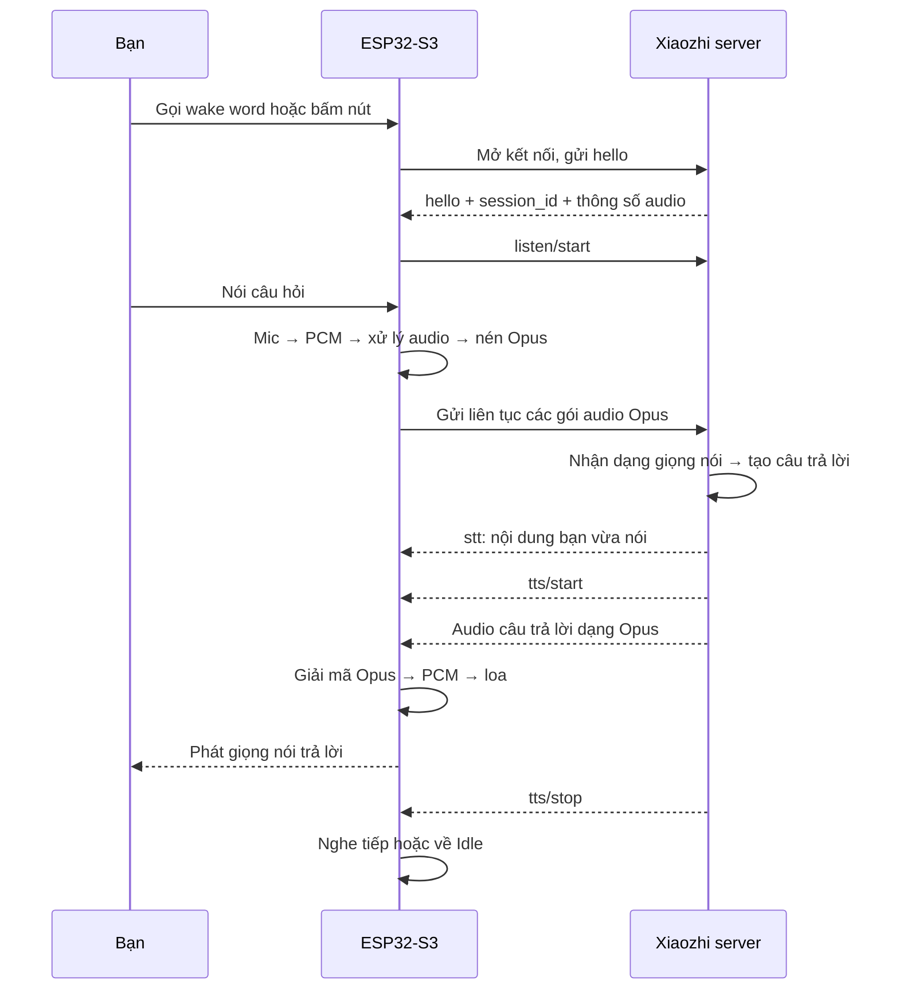

ESP đóng vai trò “tai và miệng”: thu giọng nói gửi lên Xiaozhi, rồi nhận audio trả lời về để phát loa. Phần nhận dạng câu nói và tạo câu trả lời nằm phía server.

Dựa trên code hiện tại của project, flow như sau:

1. ESP biết địa chỉ server bằng cách nào?

Sau khi có mạng, firmware gọi dịch vụ OTA/config, gửi thông tin thiết bị và firmware. Phản hồi có thể chứa cấu hình kết nối MQTT hoặc WebSocket, được lưu vào NVS.

Khi khởi tạo protocol, code ưu tiên:
- Có cấu hình MQTT → dùng MqttProtocol.
- Nếu không, có cấu hình WebSocket → dùng WebsocketProtocol.
- Không có cả hai → thử MQTT mặc định.
Vì vậy, chỉ nhìn source chưa kết luận được thiết bị đang dùng đường nào; điều đó phụ thuộc cấu hình nhận về lúc chạy.

Xem [ota.cc (line 78)](C:/Users/ASUS/Documents/PROJECT/Robotics/ESP-IDF_Ruby_RobotCar/main/ota.cc:78) và [application.cc (line 528)](C:/Users/ASUS/Documents/PROJECT/Robotics/ESP-IDF_Ruby_RobotCar/main/application.cc:528).

2. Khi bạn gọi robot, ESP gửi gì trước?

Wake word được phát hiện ngay trên ESP. Khi được đánh thức hoặc bấm nút, ESP mở kênh audio nếu cần, rồi gửi hello để báo khả năng của mình:
- Audio dùng Opus.
- Audio gửi lên: 16 kHz, mono, mỗi frame 60 ms.
- Có hỗ trợ MCP.
- Có thể báo hỗ trợ AEC phía server tùy cấu hình.
Server trả hello, trong đó có session_id để nhận diện phiên hội thoại và thông số audio trả về.

Sau đó ESP gửi lệnh bắt đầu nghe, ví dụ:
{
  "session_id": "...",
  "type": "listen",
  "state": "start",
  "mode": "auto"
}
Nếu bật CONFIG_SEND_WAKE_WORD_DATA, firmware còn gửi audio wake word đã lưu đệm và thông báo listen/detect.

3. Khi bạn nói, ESP gửi audio hay gửi chữ?

Đường hội thoại này gửi audio đã nén, không phải ESP tự chuyển cả câu hỏi thành chữ.

Luồng trong firmware:
Microphone
  → AudioCodec đọc mẫu âm thanh PCM
  → AudioInputTask
  → AudioEngine xử lý audio
  → OpusCodecTask nén thành Opus
  → audio_send_queue_
  → Application lấy từng packet
  → Protocol::SendAudio()
  → Server
Audio được chia nhỏ và gửi liên tục trong lúc nghe, nên không cần chờ thu xong một file mới upload.

Hai transport khác nhau ở cách chở dữ liệu:
Dữ liệu	WebSocket	MQTT + UDP
Lệnh và sự kiện JSON	WebSocket text frame	MQTT
Audio Opus hai chiều	WebSocket binary frame	UDP, mã hóa AES-CTR

Xem [audio README](C:/Users/ASUS/Documents/PROJECT/Robotics/ESP-IDF_Ruby_RobotCar/components/audio/README.md) và [protocol.cc (line 82)](C:/Users/ASUS/Documents/PROJECT/Robotics/ESP-IDF_Ruby_RobotCar/main/protocols/protocol.cc:82).

4. Server xử lý gì và gửi gì về?

Về mặt chức năng, luồng phía server là:
Audio bạn nói
  → STT/ASR: chuyển giọng nói thành chữ
  → AI/LLM: xử lý nội dung, tạo câu trả lời
  → TTS: chuyển câu trả lời thành giọng nói
Đây là mô tả chức năng; repository này chứa firmware nên chưa cho biết server đang dùng model hay nhà cung cấp nào.

ESP xử lý các message trả về như sau:
Message từ server	ESP làm gì
stt, có text	Nhận nội dung server nghe được, ghi log >> ...
tts/start	Chuyển trạng thái sang Speaking
tts/sentence_start, có text	Nhận chữ của câu trả lời, ghi log << ...
Audio Opus	Đưa vào hàng đợi giải mã và phát loa
tts/stop	Chuyển về nghe tiếp hoặc Idle
llm, có emotion	Cập nhật biểu cảm qua display interface
mcp	Chuyển yêu cầu cho MCP dispatcher

Board hiện tại dùng NoDisplay, nên các lời gọi hiển thị chữ/biểu cảm không tạo giao diện màn hình.

5. ESP nhận dữ liệu và “nói lại” bằng cách nào?

ESP chủ động mở kết nối ra server. Khi server gửi dữ liệu về qua kênh đã thiết lập, thư viện mạng gọi callback:
Dữ liệu mạng đến
  ├─ JSON → OnIncomingJson() → xử lý theo trường type
  └─ Audio → OnIncomingAudio()
               → audio_decode_queue_
               → OpusCodecTask giải mã thành PCM
               → audio_playback_queue_
               → AudioOutputTask
               → AudioCodec → loa
Trong code hiện tại, audio hội thoại nhận về chỉ được đưa vào hàng đợi giải mã khi ESP đang ở trạng thái Speaking. Vì vậy, message tts/start có vai trò báo ESP chuẩn bị nhận và phát câu trả lời.

ESP phát audio do server tạo ra; firmware không tự đọc chuỗi text thành giọng nói.

Phần này nằm trong [application.cc (line 555)](C:/Users/ASUS/Documents/PROJECT/Robotics/ESP-IDF_Ruby_RobotCar/main/application.cc:555).

6. Nếu câu nói yêu cầu robot thực hiện hành động?

Khi đó có thêm nhánh MCP:
Bạn yêu cầu
  → Server hiểu yêu cầu
  → Server gửi MCP tools/call
  → ESP kiểm tra tên tool và arguments
  → Chạy callback của tool
  → Gửi kết quả JSON lên server
  → Server có thể tạo lời đáp bằng giọng nói
Ví dụ tool đọc trạng thái motor là self.motor.get_state. Trạng thái phần cứng được gửi khi tool tương ứng được gọi, qua một luồng riêng với audio.

Lưu ý trong source hiện tại: hai tool self.motor.move_distance và self.motor.rotate_angle đang bị comment, nên chưa được đăng ký để server gọi. Xem [mcp_tools.cc (line 91)](C:/Users/ASUS/Documents/PROJECT/Robotics/ESP-IDF_Ruby_RobotCar/main/robot/mcp/mcp_tools.cc:91).