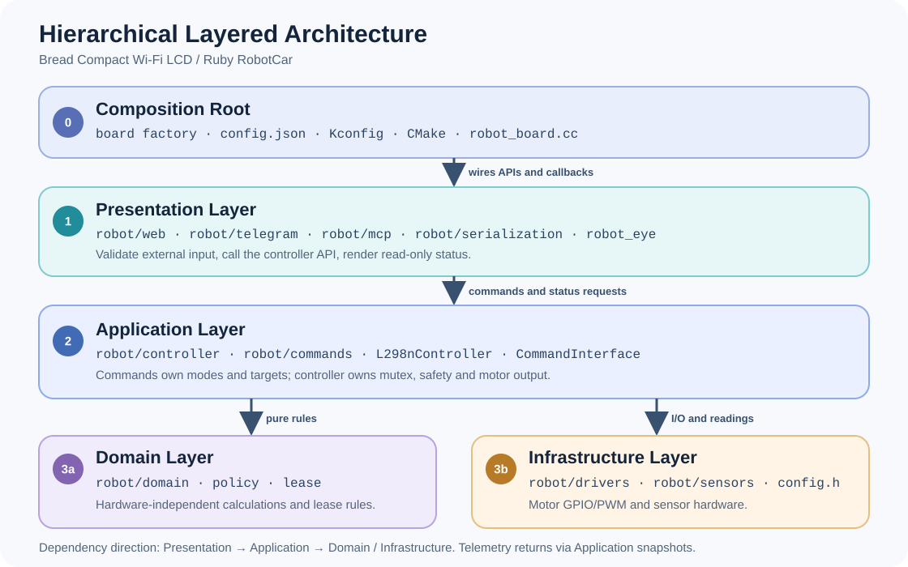

# Hierarchical Layered Architecture — Ruby RobotCar

## 1. Introduction

**Hierarchical Layered Architecture** chia module thành các layer có trách nhiệm
rõ ràng. Layer nhận yêu cầu chỉ gọi API của layer điều phối; layer điều phối quyết
định chế độ, an toàn và mục tiêu chuyển động; layer phần cứng thực hiện GPIO/PWM
và đọc cảm biến. Dữ liệu trả về đi qua **Read-only Snapshot** của controller.
Nhờ vậy, thêm một giao diện hoặc chế độ lái không tạo thêm đường điều khiển motor
riêng và không buộc core XiaoZhi biết chi tiết của board này.

Tài liệu này là quy ước cho `main/boards/bread-compact-wifi-lcd/`.

**Dependency Rule:** `Presentation → Application → Domain / Infrastructure`.
`Domain Layer` không phụ thuộc phần cứng. `Infrastructure Layer` không gọi ngược
lên controller hoặc giao diện. `Composition Root` nối các thành phần khi khởi tạo;
core XiaoZhi tiếp tục dùng giao diện `Board` chung.

## 2. Architecture Diagram



Mũi tên thể hiện chiều **gọi và phụ thuộc**. Sensor readings đi lên qua controller;
Web, Telegram, MCP và màn hình đọc trạng thái từ snapshot hoặc callback chỉ đọc.
Không có đường gọi trực tiếp từ `Presentation Layer` xuống GPIO/PWM.

## 3. Source Structure

```text
main/boards/bread-compact-wifi-lcd/
├── config.json                 Composition Root: board variant và chip target
├── config.h                    Board configuration: chân và hiệu chuẩn phần cứng
├── compact_wifi_board_lcd.cc   Composition Root: một DECLARE_BOARD, LCD/audio/network
├── robot/
│   ├── robot_board.{h,cc}      Composition Root: nối controller, adapter, display
│   ├── web/                    Presentation Layer: HTTP API và web_page.h
│   ├── telegram/               Presentation Layer: bot, lệnh và thông báo
│   ├── mcp/                    Presentation Layer: device-side MCP tools
│   ├── serialization/          Presentation Layer: encoder → JSON
│   ├── commands/               Application Layer: chế độ và mục tiêu hai bánh
│   │   ├── command_interface.* Chọn một chế độ đang chạy
│   │   ├── manual_command.*    Mục tiêu hai bánh khi lái thủ công
│   │   ├── time_drive_command.* Hướng, thời hạn và số liệu PI của TimeDrive
│   │   └── wheel_command.h     Kiểu dữ liệu mục tiêu hai bánh
│   ├── controller/             Application Layer: thực thi và an toàn
│   │   ├── l298n_controller.*  Public API, khởi tạo và Read-only Snapshot
│   │   ├── web_control.cc      Chuyển Web command thành lệnh controller
│   │   ├── motion_executor.cc  Timer, deadline, chuyển động và dừng
│   │   ├── motor_output.cc     Chuyển wheel targets sang motor driver
│   │   ├── speed_control.cc    Phản hồi Speed PI từ encoder
│   │   └── speed_pi.h          Thuật toán PI thuần, hiện đặt cạnh controller
│   ├── domain/                 Domain Layer: motion_policy, WebControlSession
│   ├── drivers/                Infrastructure Layer: L298N GPIO/LEDC
│   ├── sensors/                Infrastructure Layer: FC-03, HC-SR04, MPU6050
│   └── tests/                  Kiểm tra web page và các kiểm tra board-local
├── robot_eye/                  Presentation Layer: LVGL display và animation
└── docs/                       Tài liệu của board, gồm file này
```

`main/CMakeLists.txt` chọn source có điều kiện. Khi thêm board hoặc variant mới,
phải cập nhật đủ `config.json → scripts/build.py → main/Kconfig.projbuild →
main/CMakeLists.txt → board source/config.h`; giữ đúng một `DECLARE_BOARD` và
danh tính board riêng để không ảnh hưởng OTA của board cũ.

### Quyền sở hữu của từng layer

| Layer                    | Được làm                                                                                                                         | Không được làm                                                          |
| ------------------------ | -------------------------------------------------------------------------------------------------------------------------------- | ----------------------------------------------------------------------- |
| **Presentation Layer**   | Validate input, gọi `l298n_controller.h`, format HTTP/JSON/Telegram/MCP, render display.                                         | Include `controller_internal.h`; tự đặt GPIO/PWM; tự đổi `CommandMode`. |
| **Application Layer**    | Khóa mutex, cấp/thu quyền, chọn mode, kiểm tra `Application` state, deadline, sensor freshness, lỗi; gọi driver và tạo snapshot. | Đưa HTTP, Telegram hoặc LVGL vào logic điều khiển motor.                |
| **Domain Layer**         | Tính toán thuần từ tham số được truyền vào: joystick mixing, ngưỡng, token/sequence/deadline.                                    | Dùng ESP-IDF driver, `config.h`, singleton mạng hoặc `Application`.     |
| **Infrastructure Layer** | Điều khiển motor, lấy mẫu cảm biến và báo lỗi/telemetry.                                                                         | Parse request; chọn nguồn lệnh, mode hoặc thời điểm cho phép xe chạy.   |
| **Composition Root**     | Tạo board, khởi tạo module, nối callback và chọn source.                                                                         | Chứa vòng điều khiển motor hoặc luật chuyển mode.                       |

`robot_eye/` nhận Wi-Fi, nhiệt độ và trạng thái xe qua callback; màn hình không
include motor controller. `robot/serialization/` chỉ chuyển dữ liệu sang JSON,
không lấy mẫu encoder. Adapter có thể khác nhau về định dạng request, nhưng cùng
dùng API controller và cùng tuân theo một đường dừng motor.

## 4. Command Interface

`CommandInterface` chọn một chế độ tại một thời điểm: `kIdle` (không chạy),
`kManual` (lái thủ công) hoặc `kTimeDrive` (chạy theo thời gian). Mỗi chế độ giữ
logic riêng trong `manual_command.*` hoặc `time_drive_command.*`.

`TimeDrive` nhận hướng, tốc độ và số giây; hướng có thể là tiến, lùi, xoay trái
hoặc xoay phải. Xe tự dừng khi hết giờ. Nó không đo quãng đường hoặc góc xoay để
quyết định điểm dừng.

Luồng chung: **Command Interface → Controller → Speed PI/PWM → Motor Driver**.
`kManual` dùng Speed PI khi đã cấu hình; `kTimeDrive` yêu cầu Speed PI sẵn sàng.
Khi thêm chế độ, đặt trạng thái và luật riêng của nó trong file mới; chỉ thêm
phần chọn chế độ vào `CommandInterface`. Không cần viết lại Speed PI hoặc Motor Driver.

## 5. Control Flow and Safety

Ví dụ khi người dùng kéo joystick trên Web:

1. Web gửi hướng và tốc độ đến Controller.
2. Controller kiểm tra phiên điều khiển còn hợp lệ; `CommandInterface` giữ tốc độ
   yêu cầu cho hai bánh.
3. Speed PI điều chỉnh tốc độ theo FC-03 nếu đã cấu hình. Motor Driver xuất
   GPIO/PWM để xe chạy.
4. Web, Telegram, MCP và màn hình chỉ đọc trạng thái xe để hiển thị.

Các quy tắc dừng phải luôn được giữ:

- Web không gửi lệnh hợp lệ trong **600 ms**, hoặc mất Wi-Fi: dừng motor và hủy
  phiên điều khiển Web.
- Lệnh dừng khẩn dừng motor và hủy phiên. Nút Stop trong phiên Web chỉ dừng bánh;
  phiên vẫn còn để người dùng tiếp tục lái.
- **TimeDrive** chạy tối đa **30 giây**. Dù bắt đầu từ Web hay Voice,
  nó cần Wi-Fi và phải dừng khi mất Wi-Fi.
- `TimeDrive` dùng dữ liệu FC-03 để kiểm tra Speed PI. HC-SR04 không tham gia
  điều kiện bắt đầu hoặc dừng của chế độ này.
- Lỗi xuất motor được ghi lại và xe không tự chạy lại.

Controller tự kiểm tra thời hạn, không phụ thuộc việc trình duyệt còn mở. Callback
từ Wi-Fi hoặc cảm biến có thể chạy ở task khác; nếu cần đổi trạng thái
`Application`, dùng `Application::Schedule()`. Không chặn timer motor hoặc audio
task bằng xử lý mạng hay công việc nặng.

## 6. Change Checklist

Khi thêm mode hoặc đầu vào mới:

1. Ghi rõ nguồn yêu cầu, điều kiện vào/thoát, timeout, mất mạng, thiếu sensor,
   lỗi và stop.
2. Thêm transition vào `CommandInterface` nếu có mode mới. Logic thuần đặt trong
   `Domain Layer`; quyền cho phép chạy vẫn thuộc controller.
3. Dùng public API và đường `ApplyCommandLocked` → Speed PI/PWM → driver. Không
   gọi driver từ Web, Telegram, MCP, `robot_eye` hay sensor task.
4. Cập nhật snapshot, adapter, cấu hình source và tài liệu nếu contract đổi.
5. Kiểm tra chuyển mode, hết hạn, dừng, mất mạng, lỗi sensor/PI và mọi giao diện
   bị ảnh hưởng. Trước khi phát hành, build variant liên quan và thử dừng motor
   trên phần cứng; build không thay thế kiểm tra trên xe.

Không đổi chân của board hiện có để hỗ trợ phần cứng khác. Tạo board hoặc release
variant có danh tính riêng theo `docs/custom-board.md` ở gốc dự án.
